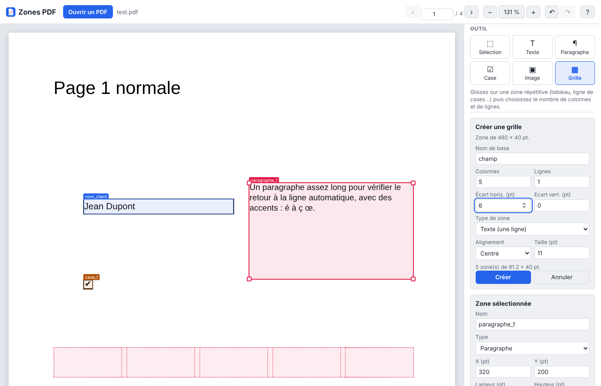

# Zones PDF

**Délimitez des zones sur n'importe quel PDF, récupérez leurs coordonnées
exactes et remplissez le document — directement dans votre navigateur.**



Zones PDF sert à préparer le remplissage automatique d'un PDF existant
(formulaire scanné, fiche, attestation, gabarit…) : vous dessinez à la souris
l'emplacement de chaque champ, et l'outil vous donne ses coordonnées précises,
prêtes à être utilisées dans un tableur, un script ou une application. Vous
pouvez aussi saisir un texte d'essai dans chaque zone et télécharger le PDF
rempli pour vérifier le résultat.

🔒 **Rien n'est envoyé sur Internet** : le PDF est lu et modifié dans votre
navigateur, sur votre appareil. Le site n'est qu'un ensemble de fichiers
statiques, sans serveur ni compte.

## Fonctionnalités

- Ouverture de **n'importe quel PDF** (multi-pages, pages tournées, formats
  non standard), par bouton ou glisser-déposer.
- Cinq outils :
  - **Texte** : un champ sur une ligne (un clic pose une zone de taille
    standard, un glisser la dessine à la bonne taille) ;
  - **Paragraphe** : texte avec retour à la ligne automatique ;
  - **Case à cocher** ;
  - **Image** : emplacement pour une photo, un logo, une signature… ;
  - **Grille** : découpe une zone en colonnes × lignes pour créer d'un coup
    toute une rangée de champs (tableaux, cases d'un formulaire).
- Déplacement à la souris ou au doigt, redimensionnement par les coins,
  réglage fin au clavier ou dans le panneau (position, taille, alignement,
  taille du texte, interligne).
- Annuler / rétablir, dupliquer, renommer.
- **Export des coordonnées** en JSON ou en CSV (pour Excel / LibreOffice),
  et ré-import du JSON pour reprendre un travail.
- **PDF rempli** avec les textes d'essai, les cases cochées et les images
  choisies (polices Helvetica, Times ou Courier), avec en option le contour
  des zones pour vérifier le placement.
- Mémorisation automatique des zones de chaque fichier sur l'appareil.
- Utilisable sur ordinateur, tablette et téléphone ; thème clair ou sombre
  selon le système.

## Format des coordonnées

Toutes les mesures sont en **points PDF** (1 pt = 1/72 de pouce ≈ 0,353 mm).

```json
{
  "format": "zones-pdf",
  "version": 1,
  "document": {
    "name": "formulaire.pdf",
    "pageCount": 1,
    "pages": [{ "page": 1, "width": 595.28, "height": 841.89, "rotate": 0 }]
  },
  "units": "pt",
  "font": "Helvetica",
  "zones": [
    {
      "name": "nom_client",
      "page": 1,
      "type": "text",
      "x": 100, "y": 222, "width": 200, "height": 20,
      "pdf": { "x": 100, "y": 599.89, "width": 200, "height": 20 },
      "align": "left",
      "size": 12,
      "value": "Jean Dupont"
    }
  ]
}
```

- `x`, `y`, `width`, `height` : rectangle de la zone, mesuré depuis le
  **coin haut-gauche de la page telle qu'elle s'affiche** (comme dans un
  logiciel de dessin).
- `pdf` : le même rectangle dans le **repère natif du PDF** (origine en
  **bas** à gauche, rotation de page et zone de recadrage prises en compte).
  C'est la valeur à utiliser avec pdf-lib, PyPDF / ReportLab, iText, etc.
- `type` : `text`, `multiline`, `checkbox` ou `image`.
- Pour les textes : `align` (`left`, `center`, `right`), `size` (taille de
  police en points) et, pour les paragraphes, `lineHeight` (interligne).
- `value` : le texte d'essai saisi (optionnel). Pour une case, toute valeur
  non vide (sauf `0`, `non`, `false`) signifie « cochée ».

Le CSV contient les mêmes informations, une zone par ligne (séparateur `;`,
décimales avec une virgule).

## Utiliser l'outil

### En ligne

Une fois publié sur GitHub Pages (voir plus bas), il suffit d'ouvrir l'adresse
du site.

### Sur votre ordinateur

Le site utilise des modules JavaScript : il doit être servi par un petit
serveur web local (un double-clic sur `index.html` ne suffit pas).

```bash
npm start            # http://localhost:8080
# ou, sans Node :
python3 -m http.server 8080
```

## Publier sur GitHub Pages

Le dépôt contient déjà le workflow `.github/workflows/pages.yml`, qui lance
les tests puis publie le site à chaque push sur `main`. Il suffit de
l'activer une fois : **Settings → Pages → Build and deployment → Source :
GitHub Actions**. Le site sera disponible à
`https://<utilisateur>.github.io/<dépôt>/`.

## Développement

Aucune étape de compilation : ce sont des fichiers HTML, CSS et JavaScript
(modules ES) servis tels quels.

```
index.html           Page unique de l'application
css/style.css        Styles (clair / sombre, adapté aux mobiles)
js/app.js            Interface : affichage, outils, souris / tactile, exports
js/model.js          Modèle pur (zones, grilles, repères, import / export)
js/filler.js         Remplissage du PDF avec pdf-lib
vendor/              PDF.js et pdf-lib embarqués (voir THIRD_PARTY_NOTICES.md)
test/                Tests Node : npm test
```

Les tests (`npm test`, Node 18 ou plus récent) couvrent le modèle, les
conversions de repère (pages normales, tournées) et le remplissage d'un PDF.

## Licence

Code sous licence [MIT](LICENSE). Les bibliothèques embarquées gardent leur
propre licence (Apache-2.0 pour PDF.js, MIT pour pdf-lib) : voir
[THIRD_PARTY_NOTICES.md](THIRD_PARTY_NOTICES.md).
